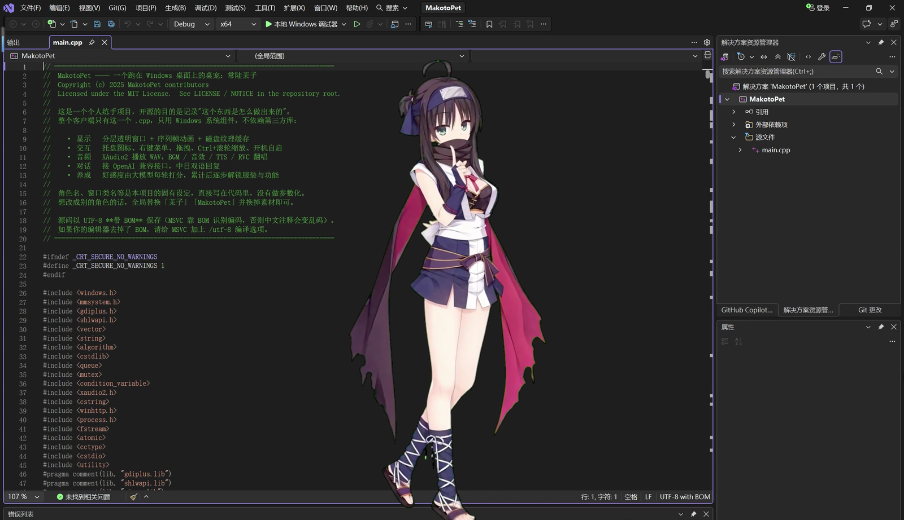
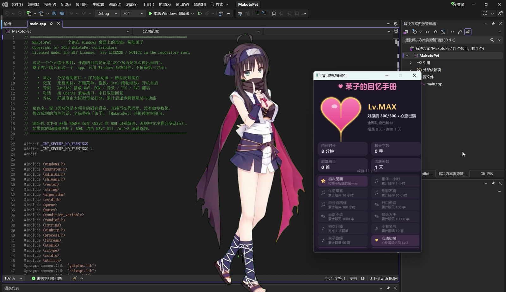

# MakotoPet

一个跑在 Windows 桌面上的桌宠：常陆茉子。透明分层窗口 + 序列帧动画，可以聊天、唱歌、翻唱，并带一套好感度养成与成就系统。

整个客户端是 **单文件 C++（main.cpp）**，只用 Windows 系统组件，不依赖任何第三方库。

> 这是一个个人练手项目，开源是为了记录"这个东西是怎么做出来的"。
> 角色名、窗口类名都是本项目的固有设定，直接写在代码里，没有做成可配置的通用框架。

<p align="center">
  
  
</p>

---

## ✨ 功能

| 分类 | 说明 |
|---|---|
| 显示 | 分层透明窗口、序列帧动画、Ctrl+滚轮无级缩放、鼠标拖拽 |
| 交互 | 托盘图标 + 右键菜单、点击角色随机动作、开机自启 |
| 音频 | XAudio2 播放、音量调节、BGM 切换 |
| 对话 | 接 OpenAI 兼容接口的大模型对话，中日双语回复 |
| 语音 | 接 GPT-SoVITS，把回复念出来 |
| 翻唱 | 接 RVC 服务，选一首歌做音色替换，支持变调档位 |
| 养成 | 好感度由模型每轮给出，累计到 300 触顶（爱心全满、Lv.MAX），途中逐步解锁服装/功能 |
| 成就 | 31 项成就面板，陪伴时长、聊天、翻唱、好感度解锁均可查 |

---

## 🔨 编译

**环境**：Windows 10/11 + Visual Studio 2019 及以上，C++14。

1. 新建「Windows 桌面应用程序」空项目，把 `main.cpp` 加进去
2. 确认链接了这些系统库（文件里已用 `#pragma comment` 声明，通常无需手动加）  
   `gdiplus.lib` `shlwapi.lib` `winmm.lib` `advapi32.lib` `xaudio2.lib` `winhttp.lib`
3. 选 x64 / Release，编译

首次启动会在 exe 同级目录生成 `config.ini`、`stats.ini`。

### 开发模式

`main.cpp` 顶部有开发人员开关（发布时务必为 0）：

```cpp
#define DEV_UNLOCK_ALL 0   // 改成 1：不看好感度，全部功能立即开放，方便测试
```

不想每次改代码，可以在 VS 里复制一个「Debug-Dev」配置，在项目属性 → 预处理器定义里加 `DEV_UNLOCK_ALL=1`。

---

## ⚙️ 配置

把 `*.example.ini` 复制成对应的 `*.ini` 放在 exe 同级目录：

| 文件 | 作用 | 是否含密钥 |
|---|---|---|
| `config.example.ini` → `config.ini` | 服装、音量、缩放、位置、BGM、翻唱变调 | 否 |
| `llm.example.ini` → `llm.ini` | 大模型接口地址、**API Key**、TTS 服务 | **是** |

`prompt.txt` 是角色人设提示词，缺失时会用代码内置的默认版本。

RVC 翻唱没有单独的 ini。服务地址、端口、模型名是编译期常量，在 `main.cpp`
的 RVC 模块开头：

```cpp
static const wchar_t* RVC_MODEL = L"mako.pth";
static const wchar_t* RVC_HOST  = L"127.0.0.1";
static const int      RVC_PORT  = 5050;
```

改成自己的服务地址与模型名，重新编译即可。

> ⚠️ `llm.ini` 里有你的 API Key，`.gitignore` 已排除它和所有 `*.ini`。  
> 提交前请确认这些文件没有被 `git add` 进去。

---

## 📂 目录结构

```
exe 所在目录
├─ MakotoPet.exe
├─ config.ini        ← 本机配置（不入库）
├─ llm.ini           ← 含密钥（不入库）
├─ prompt.txt        ← 人设提示词（不入库）
├─ Animations\       ← 序列帧：Animations\{服装}\{动作}\*.png（不入库）
├─ AnimCache\        ← 自动生成的纹理缓存，可随时删除
├─ Audio\BGM.wav     ← BGM
└─ *.wav             ← startup / exit / think / peace / costume1~3
```

`Animations` 下按 `服装\动作` 两级组织，程序扫描目录自动识别帧数与顺序，增删图片不用改代码。

四套服装 × 四个动作，目录名取自代码里的 `Costume` / `AnimState` 枚举：

```
Animations\
├─ Ninja\  Idle\ Run\ Think\ Peace\
├─ Daily\  ...
├─ School\ ...
└─ Dress\  ...
```

> 序列帧属于角色素材，不随仓库分发（见下方「关于角色素材」）。
> 一套都没放时程序仍能启动，会在人物位置弹出提示告诉你去哪儿放图，不会白屏无响应。

---

## 🔒 隐私与调试

默认**不会**把对话内容打到调试输出。

`main.cpp` 顶部有开关，排查解析问题时临时打开：

```cpp
#define PET_ENABLE_DEBUG_LOG 0   // 改成 1：把 LLM 原始响应打到 VS 输出窗口
```

开着的时候，任何装了 DebugView 或挂了调试器的人都能看到对话正文，用完请改回 0。Release 版本不建议开。

---

## ⚠️ 关于角色素材

代码以 MIT 许可发布，但**角色立绘、序列帧、语音、音乐、模型不包含在本仓库中**，也不受 MIT 覆盖。

默认角色「常陆茉子」为既有作品角色，其形象与姓名的著作权归原权利人所有。请自行确认授权范围，或替换为拥有合法权利的原创角色。详见 [NOTICE](NOTICE)。

本仓库 `screenshots\` 下的截图仅用于演示程序运行效果，其中出现的角色立绘同样不随仓库分发、不受 MIT 覆盖。

---

## 📄 许可

[MIT License](LICENSE) — 见 [NOTICE](NOTICE) 了解第三方依赖与素材说明。
